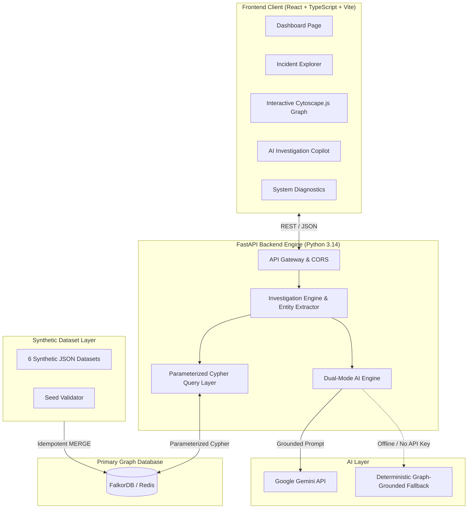
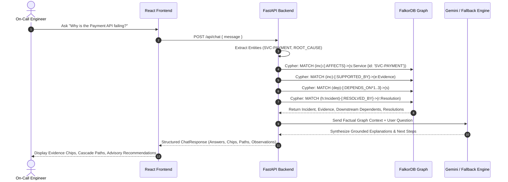

# GraphSentinel AI

> **See the Impact. Find the Cause.**  
> *Graph-Powered Incident Intelligence Agent backed by FalkorDB.*

---

## 🌟 Executive Summary

**GraphSentinel AI** is an AI-assisted DevOps/SRE incident investigation platform that uses **FalkorDB** as its central graph database. In modern microservice and distributed cloud environments, incidents rarely happen in isolation; a database connection pool starvation or cache eviction storm cascades across service boundaries, resulting in cryptic timeouts and downstream outages.

GraphSentinel AI transforms raw telemetry into an interconnected knowledge graph, enabling on-call engineers to:
1. **Trace Downstream Failure Cascades:** Perform multi-hop graph traversal to discover impacted services before customer SLA violations occur.
2. **Synthesize Telemetry Evidence:** Correlate log exceptions, metric anomalies (CPU, latency, connection starvation), and distributed traces directly to incident nodes.
3. **Retrieve Historical Incident Memory:** Search past incident resolutions and evaluate historical effectiveness using graph topology matching.
4. **Deliver Evidence-Grounded AI Copilot Responses:** Query incidents in natural language with strict grounding against FalkorDB graph facts, backed by a deterministic fallback engine when external AI APIs are offline.

---

## 🏆 Hackathon Tracks & Problem Statement

### Proposed Tracks:
- **Primary:** DevOps & Cloud Infrastructure Intelligence / Graph-Powered AI Agents
- **FalkorDB Feature Track:** High-Performance Graph Traversal for Real-Time Topology & Telemetry Analysis

### The Problem:
During major production outages (P1/P2), on-call engineers face alert fatigue, disconnected monitoring dashboards, and tribal knowledge silos. Traditional relational or document stores cannot easily traverse dynamic service-to-service and service-to-infrastructure dependencies without expensive, recursive queries.

### The GraphSentinel Solution:
By utilizing FalkorDB's native Cypher engine, GraphSentinel AI computes multi-hop dependency paths and root-cause evidence links in single-digit milliseconds, providing actionable advisory guidance in high-pressure situations.

---

## 📐 Architecture & Data Flow

### System Architecture Diagram



### Incident Investigation Data Flow



---

## 📊 Graph Data Model

GraphSentinel AI defines a graph schema optimized for real-time root-cause analysis and dependency tracing:

### Node Labels & Properties

| Label | Key Properties | Description |
| :--- | :--- | :--- |
| **`Service`** | `id`, `name`, `description`, `criticality`, `status`, `team` | Microservice or platform application component. |
| **`Infrastructure`** | `id`, `name`, `type`, `environment`, `status` | Underlying database, cache cluster, message broker, or cloud host. |
| **`Incident`** | `id`, `title`, `description`, `severity`, `status`, `created_at`, `updated_at` | Active or historical operational incident. |
| **`Evidence`** | `id`, `source_type`, `description`, `timestamp`, `metric_name`, `metric_value`, `unit` | Concrete telemetry: logs, metric spikes, APM traces, or alerts. |
| **`Resolution`** | `id`, `description`, `outcome`, `effectiveness`, `applied_at` | Documented mitigation or permanent fix applied to an incident. |

### Relationships

```
(Service)-[:DEPENDS_ON]->(Service)
(Service)-[:CONNECTS_TO]->(Infrastructure)
(Incident)-[:AFFECTS]->(Service)
(Incident)-[:SUPPORTED_BY]->(Evidence)
(Incident)-[:RESOLVED_BY]->(Resolution)
```

---

## 🔍 Key Cypher Queries

All Cypher queries in GraphSentinel AI are parameterized to prevent injection:

### 1. Downstream Multi-Hop Cascade Impact
```cypher
MATCH p = (dep:Service)-[:DEPENDS_ON*1..3]->(root:Service {id: $root_id})
RETURN dep.id AS impacted_id,
       dep.name AS impacted_name,
       dep.criticality AS criticality,
       dep.status AS current_status,
       length(p) AS hops,
       [n in nodes(p) | n.id] AS dependency_path
ORDER BY hops ASC;
```

### 2. Supporting Evidence Telemetry for an Incident
```cypher
MATCH (i:Incident {id: $incident_id})-[:SUPPORTED_BY]->(e:Evidence)
RETURN e.id, e.source_type, e.description, e.timestamp, e.metric_name, e.metric_value, e.unit
ORDER BY e.timestamp ASC;
```

### 3. Historical Incident Memory Retrieval
```cypher
MATCH (h:Incident)-[:AFFECTS]->(target:Service)
WHERE (target.id = $service_id OR (target)-[:DEPENDS_ON]->(:Service {id: $service_id}))
  AND h.id <> $current_incident_id 
  AND h.status IN ['RESOLVED', 'MITIGATED']
OPTIONAL MATCH (h)-[:RESOLVED_BY]->(r:Resolution)
RETURN h.id, h.title, h.severity, target.name, r.description, r.outcome, r.effectiveness
LIMIT 5;
```

---

## 📦 Synthetic Dataset Overview

Under `backend/data/`, GraphSentinel AI contains a synthetic dataset specifically generated for demonstration and testing.

> **Notice:** All services, logs, metrics, incidents, and employee team references in this dataset are purely synthetic and fictional. No confidential company data, credentials, or proprietary information is included.

### Dataset Summary:
- **Services (16):** API Gateway, Auth Service, Payment API, Checkout Orchestrator, Order Service, User Profile, Inventory, Catalog, Search & Recommendations, Notification Worker, Billing, Fraud Engine, Shipping, Promotions, Reviews, Telemetry Analytics.
- **Infrastructure (8):** Aurora PostgreSQL Primary, Aurora Replica, Redis Cluster, Kafka Broker, RabbitMQ, AWS EKS, ALB, Cloudflare DNS.
- **Dependency Relationships (48):** 32 service-to-service links + 16 service-to-infrastructure links.
- **Incidents (42):** Varied severity (`P1_CRITICAL` through `P4_LOW`) and statuses (`OPEN`, `INVESTIGATING`, `MITIGATED`, `RESOLVED`).
- **Evidence Telemetry (68):** Structured logs, metric spikes (connection wait times, cgroup throttles, latency), Datadog/Prometheus alerts, and APM trace spans.
- **Resolutions (16):** Detailed past remediations with outcomes (`SUCCESS`, `PARTIAL_SUCCESS`) and effectiveness ratings.

---

## 🚀 Quickstart & Setup Guide

### Prerequisites
- Python 3.10+ (tested on Python 3.14)
- Node.js 18+ (tested on Node v24)
- FalkorDB (via Docker or FalkorDB Cloud)

### 1. Database Setup

#### Option A: Use Local FalkorDB Docker Container (Recommended)
If you already have FalkorDB running on port 6379, GraphSentinel AI connects directly.
Otherwise, start FalkorDB with persistent volume storage:
```bash
docker run -p 6379:6379 -p 3000:3000 -v graphsentinel_data:/var/lib/falkordb/data falkordb/falkordb:latest
```
*(Or run `docker-compose up -d falkordb`)*

#### Option B: FalkorDB Cloud
Configure `FALKORDB_HOST`, `FALKORDB_PORT`, `FALKORDB_USERNAME`, and `FALKORDB_PASSWORD` in `.env`.

---

### 2. Backend Setup & Seeding

1. **Install Python dependencies:**
   ```bash
   pip install -r backend/requirements.txt
   ```

2. **Configure Environment:**
   Copy `.env.example` to `.env`:
   ```bash
   cp .env.example .env
   ```

3. **Validate & Seed Dataset:**
   ```bash
   # Validate synthetic dataset integrity
   python backend/validator.py

   # Seed FalkorDB graph (idempotent, safe to re-run)
   python backend/seed.py
   ```

4. **Run Backend Test Suite:**
   ```bash
   python -m pytest backend/tests/ -v
   ```

5. **Start FastAPI Development Server:**
   ```bash
   python -m uvicorn backend.app.main:app --host 127.0.0.1 --port 8000 --reload
   ```
   API interactive documentation available at: [http://localhost:8000/docs](http://localhost:8000/docs)

---

### 3. Frontend Setup

1. **Navigate to frontend directory:**
   ```bash
   cd frontend
   ```

2. **Install dependencies:**
   ```bash
   npm install
   ```

3. **Run Production Build:**
   ```bash
   npm run build
   ```

4. **Start Vite Dev Server:**
   ```bash
   npm run dev
   ```
   Open your browser at: [http://localhost:5173/](http://localhost:5173/)

---

## 🛠️ Environment Variables Reference

| Variable | Default Value | Description |
| :--- | :--- | :--- |
| `FALKORDB_HOST` | `localhost` | FalkorDB server host address |
| `FALKORDB_PORT` | `6379` | FalkorDB connection port |
| `FALKORDB_USERNAME` | *(empty)* | Optional authentication username |
| `FALKORDB_PASSWORD` | *(empty)* | Optional authentication password |
| `FALKORDB_GRAPH` | `graphsentinel` | Graph database identifier |
| `API_PORT` | `8000` | Port for the FastAPI server |
| `API_HOST` | `0.0.0.0` | Host binding for FastAPI |
| `CORS_ORIGINS` | `http://localhost:5173,http://127.0.0.1:5173` | Allowed CORS origins (comma-separated) |
| `GEMINI_API_KEY` | *(empty)* | Optional Google Gemini API key |
| `GEMINI_MODEL` | `gemini-2.5-flash` | Gemini model for grounded natural language synthesis |
| `ADMIN_SECRET` | `graphsentinel-admin-dev` | Secret header required for `/api/admin/seed` |

---

## 🎬 3-Minute Demo Script

Follow this flow for hackathon evaluations and video presentations:

1. **Dashboard Overview (`/`)**:
   - Point out live metrics from FalkorDB: 16 Services, Active Incidents, Critical P1 count, and Downstream Cascade Risk count.
   - Highlight the severity distribution and service health state (Healthy vs Degraded vs Critical).
2. **Deep Incident Investigation (`/incidents/INC-001`)**:
   - Open **`INC-001`** (Payment Gateway API Latency Spike).
   - Show the affected root service: `Payment Processing API` (`SVC-PAYMENT`).
   - Examine supporting evidence: HikariCP connection pool timeout (124 waiting threads), 504 gateway timeout spike, and Postgres query lock trace.
   - Point out the **Downstream Cascade Impact**: graph traversal shows `SVC-CHECKOUT` and `SVC-ORDER` at 1 hop and `SVC-API-GW` at 2 hops.
   - Review the diagnostic hypotheses and safe advisory recommendations.
3. **Interactive Graph Explorer (`/graph?incident=INC-001`)**:
   - View the visual Cytoscape graph canvas centered on the incident.
   - Show distinct colors: blue rectangles (Services), purple barrels (Infrastructure), red diamonds (Incidents), and amber circles (Evidence).
   - Click a node to inspect properties in the slide-out drawer.
   - Toggle layout between Force-Directed, Concentric, and Tree.
4. **AI Incident Intelligence Chat (`/chat`)**:
   - Ask: *"Why is the Payment API failing?"*
   - Observe the response grounded in graph facts: cites `INC-001`, `EVD-001`, and `EVD-002`.
   - Ask: *"Which services may be affected by this incident?"*
   - See the multi-hop dependency path: `SVC-CHECKOUT ➔ SVC-PAYMENT`.
   - Ask: *"What remediation options worked previously?"*
   - The agent retrieves past resolutions from `INC-017` (Redis Redlock idempotency patch) and `INC-021`.
   - Notice the badge showing **"Deterministic Graph Fallback"** (demonstrating zero-dependency operation) or **"Gemini AI"** if configured.
5. **System Diagnostics & Seeding (`/settings`)**:
   - Verify live FalkorDB latency probe (<10ms).
   - Demonstrate the one-click idempotent database re-seeder.

---

## 🔒 Security & Reliability

- **Zero Hardcoded Secrets:** Credentials, database passwords, and API keys are strictly configured through environment variables.
- **Parameterized Cypher:** All graph queries use parameters (`$id`, `$root_id`, etc.); user input is never interpolated into raw Cypher strings.
- **Protected Administration:** The database seed endpoint `/api/admin/seed` requires a valid `X-Admin-Secret` header.
- **Non-Destructive Advisory Recommendations:** Recommendations are advisory and require human on-call engineer review; GraphSentinel AI never executes destructive shell commands or restarts production services automatically.
- **Deterministic Offline Resilience:** If the Gemini API key is omitted, rate-limited, or unavailable, the platform seamlessly operates using its deterministic graph-grounded engine with zero loss of investigation capability.

---

## 🚀 Free-Tier Deployment Guide

### Frontend Deployment (Vercel)
1. Push the repository to GitHub.
2. In Vercel, set root directory to `frontend`.
3. Set Build Command: `npm run build`
4. Set Output Directory: `dist`
5. Configure Environment Variable: `VITE_API_URL=https://your-backend.onrender.com`

### Backend Deployment (Render)
1. Create a **Web Service** on Render pointing to your repository.
2. Set Environment: `Python 3`
3. Build Command: `pip install -r backend/requirements.txt`
4. Start Command: `python -m uvicorn backend.app.main:app --host 0.0.0.0 --port $PORT`
5. Add Environment Variables:
   - `FALKORDB_HOST`: Host of your FalkorDB Cloud instance
   - `FALKORDB_PORT`: Port of your FalkorDB Cloud instance
   - `FALKORDB_PASSWORD`: Password for your FalkorDB Cloud instance
   - `FALKORDB_GRAPH`: `graphsentinel`
   - `CORS_ORIGINS`: URL of your deployed Vercel frontend

---

## ⚖️ AI-Assistance Disclosure

In accordance with hackathon guidelines, generative AI (Google DeepMind Antigravity and Gemini) was used during development to assist with architectural ideation, synthetic dataset drafting, and unit test generation. All system design, FalkorDB Cypher queries, graph traversal algorithms, and fullstack implementations were tested, validated, and verified on local execution environments.

---

## 📄 License

GraphSentinel AI is open-source software licensed under the [Apache License 2.0](LICENSE).
