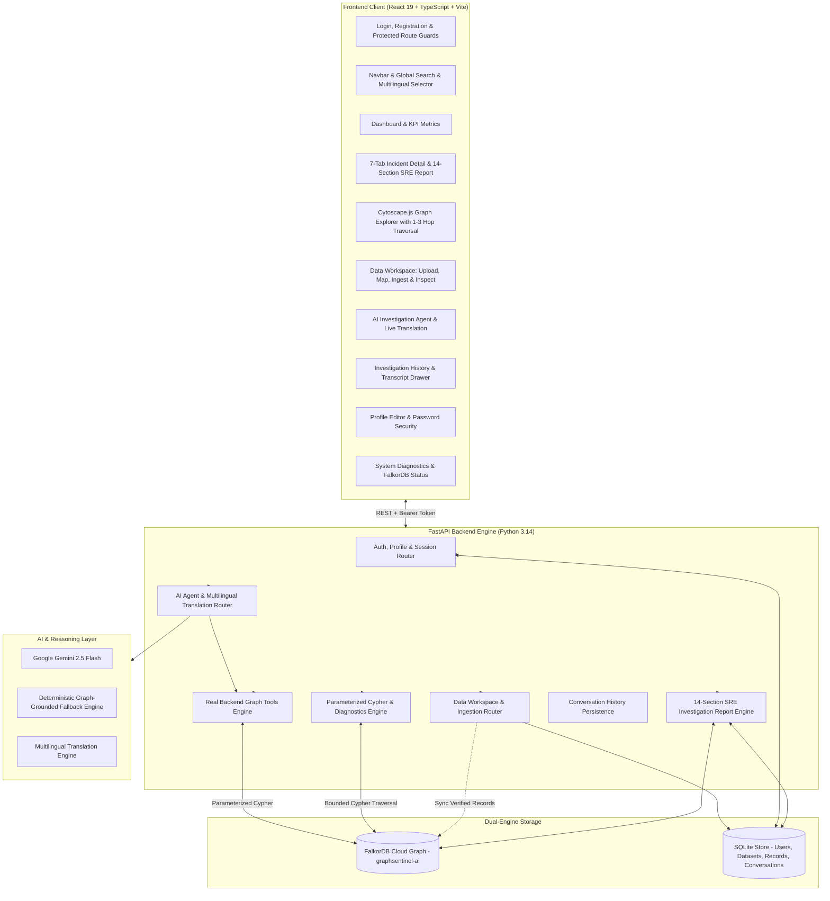

<p align="center">
  
</p>

# GraphSentinel AI — Complete Platform Upgrade

> **See the Impact. Find the Cause.**  
> *Graph-Powered Incident Intelligence, Problem Solving & Data Workspace Platform backed by FalkorDB.*

---

## 🌟 Executive Summary

**GraphSentinel AI** is an enterprise-grade AI-assisted DevOps/SRE incident intelligence, problem-solving, and data transparency platform powered by **FalkorDB** as its primary graph database. Modern distributed cloud microservices face complex cascading failures where isolated metrics fail to explain system-wide outages. 

GraphSentinel AI bridges this gap through a unified 360° incident lifecycle:
**Data Ingestion ➔ Graph Correlation ➔ Incident Detection ➔ 14-Section SRE Investigation ➔ Multilingual AI Agent ➔ Human-in-the-Loop Remediation ➔ Automated Verification ➔ Outcome Persistence.**

### Core Platform Pillars:
1. **Data Workspace & Multi-Format Ingestion:** Ingest CSV, Excel, JSON, JSONL, server/application logs, and incident reports with schema inference, column mapping, SHA-256 deduplication, and data provenance tracking.
2. **14-Section SRE Investigation & Solution Engine:** Production-ready incident reports featuring formulaic confidence scoring, contradictory/supporting evidence analysis, rollback procedures, blast radius analysis, and safety-classified commands (`READ_ONLY`, `PRIVILEGED`, `DESTRUCTIVE`).
3. **Conversational Multilingual AI Agent:** Autonomous investigation copilot powered by Gemini (with deterministic offline fallback) executing 6 real backend tools against FalkorDB, conversation resumption, and native English, Hindi, and Hinglish support with instant translation.
4. **FalkorDB Graph Intelligence:** 1-to-3 hop bounded graph traversals, Cypher-optimized downstream cascade path extraction, telemetry hiding toggles, and live graph diagnostic metrics.
5. **Full User Authentication & Profile Lifecycle:** PBKDF2-SHA256 password security, tokenized bearer sessions, user profile customization (role, timezone, team, notifications), and self-service password updates.
6. **9-View Polished Responsive UI:** Dashboard, Incidents (with 7 tabs), Services, Graph Explorer, Data Workspace, AI Agent, History, Profile, and Settings.

---

## 🔐 Authentication & Credentials

GraphSentinel AI features real, backend-enforced authentication with salted PBKDF2-SHA256 password hashing and persistent sessions stored in SQLite (`backend/data/sentinel.db`).

| Role | Email | Password | Permissions |
| :--- | :--- | :--- | :--- |
| **Site Reliability Engineer (SRE)** | `sre@graphsentinel.ai` | `SREAdmin2026!` | Full Investigation, Step Remediation, Incident Resolution, Data Ingestion |
| **New Users** | *(Self-register)* | *(Any strong pwd)* | Dedicated user profile, isolated datasets, private conversation history |

*Tip: On the login page (`/login`), click the **"Demo SRE Account"** button to auto-fill these credentials instantly.*

---

## 📐 System Architecture



---

## 🗄️ FalkorDB Graph Schema

The platform maintains and safely extends the primary `graphsentinel-ai` graph on FalkorDB:

### Node Labels
- **`Service`**: Microservices and platform components (`id`, `name`, `status`, `criticality`, `team`).
- **`Infrastructure`**: Underlying databases, caches, brokers, cloud hosts (`id`, `name`, `type`, `environment`, `status`).
- **`Incident`**: Active and historical operational incidents (`id`, `title`, `description`, `severity`, `status`, `created_at`).
- **`Evidence`**: Raw telemetry, log exceptions, metric spikes, traces (`id`, `source_type`, `description`, `metric_name`, `metric_value`, `unit`).
- **`Resolution`**: Documented fixes, runbooks, and historical mitigations (`id`, `description`, `outcome`, `effectiveness`).
- **`Dataset` / `DataSource`**: Ingested datasets and telemetry files (`id`, `name`, `source_type`, `record_count`, `provenance_type`).

### Core Relationships
```cypher
(:Service)-[:DEPENDS_ON]->(:Service)
(:Service)-[:CONNECTS_TO]->(:Infrastructure)
(:Incident)-[:AFFECTS]->(:Service)
(:Incident)-[:SUPPORTED_BY]->(:Evidence)
(:Incident)-[:RESOLVED_BY]->(:Resolution)
(:Incident)-[:DERIVED_FROM]->(:Dataset)
```

---

## 📥 Data Workspace & Ingestion Engine

The **Data Workspace** (`/data-workspace`) provides a complete data ingestion and transparency portal:

1. **Multi-Format Support:**
   - **Tabular:** CSV (`.csv`), Excel (`.xlsx`, `.xls`)
   - **Structured:** JSON (`.json`), JSON Lines (`.jsonl`)
   - **Text & Telemetry:** Application/server logs (`.log`, `.txt`), plain-text incident reports.
2. **Interactive Ingestion Workflow:**
   - **Drag-and-Drop & File Picker:** Rapid client-side file inspection.
   - **Auto Format Detection:** MIME and extension detection with graceful error reporting for malformed files.
   - **Schema Inference & Column Mapping:** Interactive mapping of Source Columns to Standard Entities (`incident_id`, `timestamp`, `severity`, `service`, `error_message`, `root_cause_evidence`, `resolution`).
   - **Normalization & Validation:** Validates required fields, formats ISO timestamps, normalizes severity values (`P1_CRITICAL` through `P4_LOW`), and tracks rejected rows.
   - **SHA-256 Deduplication:** Prevents duplicate records across repeated uploads with idempotent storage.
   - **User Data Isolation:** Records and datasets are strictly isolated by `user_id`.
3. **Data Provenance Transparency:**
   Every record and recommendation displays its exact source classification:
   - 🔵 **Synthetic Demo Data (`SYNTHETIC_DEMO`)**: Seeded benchmark scenario data.
   - 🟢 **User-Imported Data (`USER_IMPORTED`)**: Files uploaded, mapped, and validated by users.
   - 🟣 **Verified External Data (`VERIFIED_EXTERNAL`)**: Live APM and external cloud connectors.
4. **Data Inspection Modal:**
   Click any dataset to inspect imported raw records, mapped attributes, normalization logs, and source provenance.

---

## 📋 14-Section SRE Incident Investigation & Solution Engine

For every incident (or imported problem), GraphSentinel AI compiles a structured, production-grade 14-section investigation report:

| Section # | Investigation Section | Description |
| :---: | :--- | :--- |
| **1** | **Problem Summary** | Concise, plain-language description of the operational outage. |
| **2** | **Observed Symptoms & Services** | Impacted entry points, degraded dependencies, and telemetry deviations. |
| **3** | **Severity & Business Impact** | P-tier rating, affected users/SLAs, and financial/transactional impact. |
| **4** | **Confirmed Facts** | Bulletproof, evidence-backed observations directly proven in telemetry. |
| **5** | **Potential Root Cause Hypotheses** | Ranked candidate hypotheses explicitly labelled as unconfirmed theories. |
| **6** | **Supporting & Contradicting Evidence** | Direct evidence matrix analyzing what confirms and what rules out each theory. |
| **7** | **Confidence Level & Derivation** | Transparent formula score derived from evidence count, consistency, and depth. |
| **8** | **Related Incidents & Past Resolutions** | Graph-matched historical precedents and prior effective runbooks. |
| **9** | **Recommended Solution** | Prioritized, step-by-step remediation guide for the on-call engineer. |
| **10** | **Required Commands & Safety Badges** | Human-review CLI commands with clear safety ratings (`READ_ONLY`, `PRIVILEGED`, `DESTRUCTIVE`). |
| **11** | **Validation Steps** | Explicit health checks and telemetry criteria required to confirm resolution. |
| **12** | **Rollback & Risk Considerations** | Blast radius evaluation, rollback trigger conditions, and emergency undo commands. |
| **13** | **Prevention & Monitoring** | Long-term architectural safeguards, alerting thresholds, and synthetic probes. |
| **14** | **Final Resolution Notes & Status** | Operational sign-off, post-mortem notes, and graph status transition. |

*Human Safety Guarantee:* The platform **never** executes commands automatically on production infrastructure. Destructive or privileged commands (e.g., `kubectl scale`, `systemctl restart`, `DROP INDEX`) are surfaced with high-contrast safety badges for human engineer review.

---

## 🤖 AI Investigation Agent & Backend Tools

The **AI Investigation Agent** (`/chat`) functions as an interactive copilot for incident triage:

### Real Backend Tools
Unlike traditional chatbots that hallucinate tool results, GraphSentinel AI implements 6 real backend tools:
1. `search_graph(query, label)`: Parameterized Cypher fulltext search over services, incidents, and infrastructure.
2. `get_incident_info(incident_id)`: Deep inspection of incident metadata, symptoms, and severity.
3. `trace_dependencies(service_id, depth)`: 1-to-3 hop upstream and downstream Cypher dependency traversal.
4. `find_similar_incidents(service_id, incident_id)`: Historical incident retrieval from FalkorDB memory.
5. `lookup_resolutions(incident_id)`: Runbook and resolution outcome inspection.
6. `analyze_uploaded_data(dataset_id)`: Anomaly detection and error frequency analysis across user-imported datasets.

### Multilingual Support & Instant Translation
- **Supported Languages:** **English**, **Hindi (हिंदी)**, and **Hinglish (Colloquial Hindi-English)**.
- **Language Selector:** Switch preferred language in navbar, profile, or directly in the chat header.
- **Technical Integrity Preservation:** Explanations and solution instructions are translated while preserving code snippets, shell commands, service identifiers (`SVC-PAYMENT`), and raw error logs.
- **One-Click Translation:** Any individual assistant message can be instantly translated into English, Hindi, or Hinglish via the inline translation widget.

### Investigation History & Resumption
- Every conversation is stored in SQLite under `investigation_conversations`.
- Users can review past sessions in the **Investigation History** view (`/history`), inspect full message transcripts, or resume active conversations directly in `/chat?conversation_id={id}`.

---

## 🖥️ Navigation & User Interface

The upgraded frontend provides 9 dedicated navigation destinations:

| Route | Page | Key Features |
| :--- | :--- | :--- |
| `/dashboard` | **Dashboard** | Active incident alerts, service health KPIs, recent investigations, global search. |
| `/incidents` | **Incidents** | Filterable catalog by severity (`P1`-`P4`), status, and affected service. |
| `/incidents/:id` | **Incident Detail** | 7-tab resolution suite including the full **14-Section SRE Report** with copyable Markdown and print layout. |
| `/services` | **Services** | Dependency mapping, tier classifications, owner teams, and health indicators. |
| `/graph` | **Graph Explorer** | Interactive Cytoscape.js canvas with 1-3 hop selector, evidence hide/show toggle, and live graph diagnostics modal. |
| `/data-workspace` | **Data Workspace** | Drag-and-drop upload, schema column mapper, normalization logs, deduplication, and record inspector. |
| `/chat` | **AI Agent** | Conversational investigation with real backend tools, evidence chips, and instant translation. |
| `/history` | **Investigation History** | Searchable past chat sessions, transcript modal, and conversation resumption. |
| `/profile` | **Profile & Settings** | Display name, job role, department, timezone, avatar, notifications, and secure password change. |
| `/settings` | **System Status** | FalkorDB cloud connectivity probe, Redis latency, and database diagnostics. |

---

## 🧪 Testing & Verification

The platform includes automated test suites covering data ingestion, graph integrity, 14-section SRE reports, real tools, authentication, and multilingual chat.

### Running Backend Tests
```bash
# Run the platform upgrade test suite
python -m pytest backend/tests/test_platform_upgrade.py -v

# Run the full API test suite (zero regressions)
python -m pytest backend/tests/test_api.py backend/tests/test_validator.py -v
```

**Test Results (25 of 25 Passing):**
- `test_data_ingestion_csv_parsing_and_mapping` ✅ PASSED
- `test_data_ingestion_json_and_jsonl_parsing` ✅ PASSED
- `test_data_ingestion_log_parsing` ✅ PASSED
- `test_record_normalization_and_deduplication` ✅ PASSED
- `test_14_section_investigation_report_structure` ✅ PASSED
- `test_investigation_report_endpoint` ✅ PASSED
- `test_investigation_tools_execution` ✅ PASSED
- `test_multilingual_translation_and_chat_endpoint` ✅ PASSED
- `test_auth_profile_and_password_lifecycle` ✅ PASSED
- `test_conversation_history_lifecycle` ✅ PASSED
- `test_graph_diagnostics_and_provenance_endpoints` ✅ PASSED
- `test_synthetic_dataset_is_valid` ✅ PASSED
- `test_dataset_contains_target_counts` ✅ PASSED
- `test_root_endpoint` ✅ PASSED
- `test_health_endpoint` ✅ PASSED
- `test_overview_endpoint` ✅ PASSED
- `test_services_endpoints` ✅ PASSED
- `test_incidents_endpoints` ✅ PASSED
- `test_impact_analysis_endpoint` ✅ PASSED
- `test_graph_visualization_endpoint` ✅ PASSED
- `test_chat_investigation_flow` ✅ PASSED
- `test_admin_seed_authorization` ✅ PASSED
- `test_auth_lifecycle` ✅ PASSED
- `test_incident_resolution_workflow` ✅ PASSED
- `test_global_search` ✅ PASSED

### Running Frontend Production Build
```bash
cd frontend
npm run build
```
*Result: Clean compilation via `tsc -b` and Vite bundle generation with exit code 0.*

---

## 🛠️ Environment Variables Reference

| Variable | Default Value | Description |
| :--- | :--- | :--- |
| `FALKORDB_HOST` | `localhost` | FalkorDB server host (or FalkorDB Cloud endpoint) |
| `FALKORDB_PORT` | `6379` | FalkorDB connection port |
| `FALKORDB_USERNAME` | *(empty)* | Optional authentication username |
| `FALKORDB_PASSWORD` | *(empty)* | FalkorDB Cloud password |
| `FALKORDB_GRAPH` | `graphsentinel-ai` | Primary graph identifier (preserved) |
| `API_PORT` | `8000` | Port for the FastAPI server |
| `API_HOST` | `0.0.0.0` | Host binding for FastAPI |
| `CORS_ORIGINS` | `http://localhost:5173,http://127.0.0.1:5173` | Allowed CORS origins (comma-separated) |
| `GEMINI_API_KEY` | *(empty)* | Google Gemini API key (optional, fallback available) |
| `GEMINI_MODEL` | `gemini-2.5-flash` | Gemini model for conversational investigation |
| `ADMIN_SECRET` | `graphsentinel-admin-dev` | Secret header required for `/api/admin/seed` |

---

## 🚀 Local Quickstart Guide

### 1. Backend Setup
```bash
# 1. Install dependencies
pip install -r backend/requirements.txt

# 2. Configure environment
cp .env.example .env

# 3. Start FastAPI server
python -m uvicorn backend.app.main:app --host 127.0.0.1 --port 8000 --reload
```
API docs available at: [http://localhost:8000/docs](http://localhost:8000/docs)

### 2. Frontend Setup
```bash
cd frontend

# 1. Install dependencies
npm install

# 2. Build for production
npm run build

# 3. Start local development server
npm run dev
```
Open your browser at: [http://localhost:5173/](http://localhost:5173/)

---

## 🔒 Security, Safety & Operational Boundaries

1. **Cloud Graph Data Preservation:**
   - GraphSentinel AI preserves the existing `graphsentinel-ai` graph on FalkorDB Cloud.
   - It **never** drops, deletes, or resets existing graph nodes or relationships during regular operations or tests.
2. **Zero Plaintext Credentials:**
   - User passwords are automatically hashed with PBKDF2-SHA256 (600,000 iterations) and cryptographically random salts.
   - All environment variables and cloud keys remain in local `.env` and are never logged or exposed via API.
3. **Advisory Human-in-the-Loop:**
   - Remediation commands are presented for SRE verification and manual execution.
   - Dangerous commands (`DESTRUCTIVE`, `PRIVILEGED`) are accompanied by explicit warnings and confirmation prompts.
4. **Offline Resilience & Graceful Fallback:**
   - If the Gemini API key is not supplied, rate-limited, or unreachable, the investigation agent automatically engages its deterministic graph-grounded engine, maintaining full incident triage without service disruption.

---

## 📄 License

GraphSentinel AI is open-source software licensed under the [Apache License 2.0](LICENSE).
